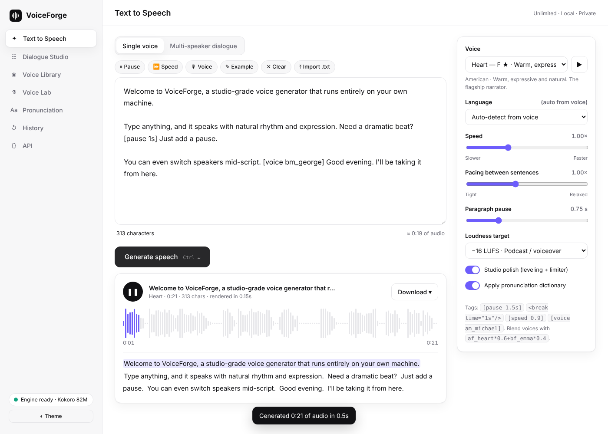

# VoiceForge Studio

A self-hosted, open-source **text-to-speech voiceover studio** with an ElevenLabs-style workflow.
It runs the [Kokoro-82M](https://huggingface.co/hexgrad/Kokoro-82M) neural TTS model (Apache-2.0)
locally on CPU, so there are **no character quotas, no per-minute fees, and your scripts never leave your machine**.



## Features

| | |
|---|---|
| **54 voices, 9 languages** | US/UK English, Spanish, French, Hindi, Italian, Japanese, Portuguese (BR), Mandarin |
| **Dialogue Studio** | Write `Host: …` / `Guest: …` lines, cast each speaker, and render the whole conversation in one pass with natural turn-taking pauses |
| **Voice Lab** | Design new voices by blending up to 5 voices (`af_heart*0.6+bf_emma*0.4`). Saved blends work everywhere, including the API |
| **Inline direction tags** | `[pause 1.5s]`, `<break time="500ms"/>` (SSML-compatible), `[speed 0.9]`, `[voice bm_george]` |
| **Pronunciation dictionary** | Aliases ("SQL" → "sequel") or exact **IPA phonemes** for names and brands |
| **Smart text normalisation** | Currency (`$12.50`, `$3M`), percentages, abbreviations (Dr., e.g.), URLs/emails, times, markdown cleanup |
| **Broadcast mastering** | Gentle leveling, LUFS loudness normalisation (−14 YouTube, −16 podcast, −19 ACX, −23 EBU R128) and a soft-knee limiter |
| **Subtitles included** | Every render comes with sentence-accurate **SRT / VTT / JSON** timings |
| **Interactive player** | Waveform scrubbing and a live transcript that highlights the current sentence; click any sentence to jump there |
| **Incremental re-renders** | Sentence-level cache: edit one paragraph of a long script and only that part is re-synthesised |
| **Long-form ready** | Up to 200k characters per job, with live per-sentence progress |
| **Exports** | MP3, WAV, FLAC, OGG/Opus, AAC, raw PCM |
| **History** | Every generation is saved; replay, re-download in any format, or reload its text |
| **Drop-in APIs** | ElevenLabs-compatible `/v1/text-to-speech/{voice_id}` (+ `/stream`, `/v1/voices`) and OpenAI-compatible `/v1/audio/speech` |

## Quick start

Requirements: Python 3.10+ and `ffmpeg` (for MP3/OGG/AAC).

```bash
./scripts/run.sh          # creates .venv, installs deps, downloads models (~350 MB), starts server
# open http://127.0.0.1:8000
```

Or manually:

```bash
python3 -m venv .venv && . .venv/bin/activate
pip install -r requirements.txt
./scripts/download_models.sh
uvicorn server.app:app --port 8000
```

Docker:

```bash
docker build -t voiceforge .
docker run -p 8000:8000 -v voiceforge-data:/data voiceforge
```

## Script syntax

```text
Narrator: The night was quiet. [pause 1s] Too quiet.
Detective: [speed 0.9] Something's not right here.
Narrator: She stepped inside. <break time="400ms"/> [voice bf_isabella] "Hello?"
```

* A blank line adds a paragraph pause (adjustable).
* `[speed …]` and `[voice …]` apply until the end of the line.
* `Name:` prefixes only count as speakers in **Dialogue** mode.
* A voice can be a built-in id (`am_michael`), a saved blend (`custom:<id>`) or a formula (`am_michael*0.7+bm_george*0.3`).

## API

```bash
# ElevenLabs-compatible
curl -X POST "http://localhost:8000/v1/text-to-speech/af_heart?output_format=mp3_44100_128" \
  -H "Content-Type: application/json" -d '{"text":"Hello world"}' -o out.mp3

# OpenAI-compatible
curl -X POST http://localhost:8000/v1/audio/speech -H "Content-Type: application/json" \
  -d '{"model":"tts-1","input":"Hello","voice":"nova"}' -o out.mp3

# Full studio render (dialogue + mastering)
curl -X POST "http://localhost:8000/api/tts?format=wav" -H "Content-Type: application/json" \
  -d '{"text":"A: Hi!\nB: Hello.","mode":"dialogue","cast":{"A":"af_heart","B":"am_michael"}}' -o d.wav
```

Interactive OpenAPI docs are served at `/docs`.

## Configuration

| Env var | Default | Purpose |
|---|---|---|
| `VF_API_KEY` | *(empty)* | When set, `/v1/*` requires `xi-api-key: <key>` or `Authorization: Bearer <key>` |
| `VF_DATA_DIR` | `./data` | History, custom voices, pronunciations, preview cache |
| `VF_MODELS_DIR` | `./models` | Location of `kokoro-v1.0.onnx` and `voices-v1.0.bin` |
| `VF_MAX_CHARS` | `200000` | Max characters per request |

## Project layout

```
server/
  app.py        FastAPI routes (studio API + ElevenLabs/OpenAI compatibility + static UI)
  pipeline.py   render pipeline, sentence cache, background jobs
  engine.py     Kokoro wrapper: voice blending, custom voices, IPA injection
  textproc.py   script parser, tags, normalisation, sentence splitting
  audio.py      mastering (LUFS, compressor, limiter), encoding, captions
  store.py      JSON/filesystem persistence
  voices.py     voice catalog metadata
web/            single-page UI (vanilla JS, no build step)
tests/          pytest suite (API tests auto-skip without model files)
```

## Tests

```bash
pip install -r requirements-dev.txt
pytest -q
```

## Honest notes

* Kokoro is a small (82M-parameter) model. It sounds very natural for narration and runs anywhere,
  but it does not do voice cloning from a sample or emotion prompting.
* Speed is roughly real-time on a modern laptop CPU. The ONNX runtime picks up a GPU automatically
  if you install `onnxruntime-gpu`.
* This is an independent project. It is not affiliated with ElevenLabs and contains none of their code, models or voices.
